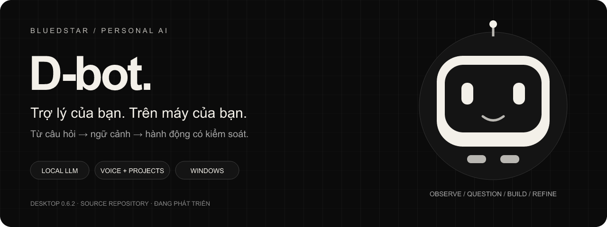
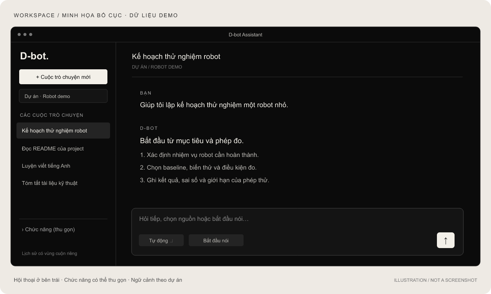
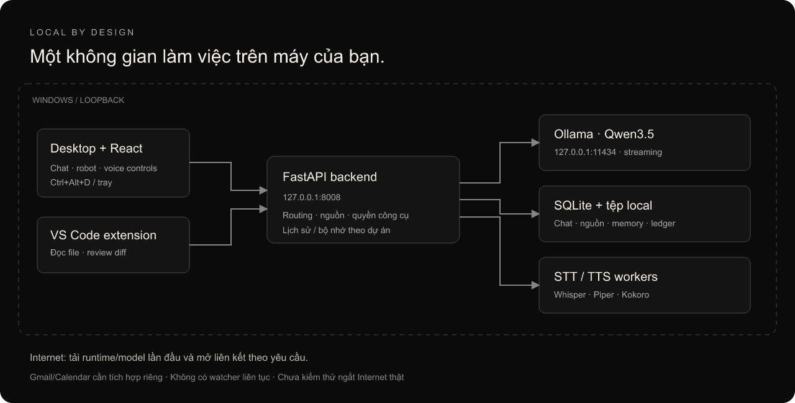

<p align="center"></p>

<p align="center"><strong>Chat • Giọng nói • Dự án • Lập trình • Học Anh–Nhật</strong><br/>Windows desktop · Electron · React · FastAPI · SQLite · Ollama</p>

<p align="center"><a href="#cài-đặt-và-mở-ứng-dụng">Bắt đầu</a> · <a href="#sử-dụng-hằng-ngày">Cách dùng</a> · <a href="#hạn-chế-cần-biết">Hạn chế</a> · <a href="docs/ROADMAP.md">Hướng nâng cấp</a></p>

# D-bot Assistant Desktop

D-bot là trợ lý cá nhân chạy trên máy Windows: trò chuyện với model local thật, lưu hội thoại theo dự án, đọc tài liệu có nguồn, đề xuất sửa code và hỗ trợ học ngoại ngữ. Ứng dụng có cửa sổ riêng, khay hệ thống và robot nhỏ nổi trên màn hình.

**Phiên bản desktop: 0.6.2.** Đây là project đang phát triển, có giới hạn về tốc độ và độ chính xác. Kho này chứa mã nguồn để tự dựng; chưa có bộ cài độc lập hoặc bản EXE phát hành để tải trực tiếp.



*Hình minh họa bố cục, dùng nội dung demo; không phải ảnh chụp phiên làm việc thật. Giao diện thực tế có thể khác.*

## D-bot làm được gì?

| Nhóm | Khả năng đã triển khai | Cách kiểm soát |
|---|---|---|
| Chat local | Streaming, dừng sinh, lưu SQLite, tiếp tục câu trả lời dài | Chọn Tự động / Nhanh / Chuyên sâu; vẫn có giới hạn context/token |
| Hội thoại & dự án | Lịch sử ưu tiên bên trái, tìm theo tiêu đề, ẩn nhóm chức năng, đổi tên/chuyển cuộc chat | Bộ nhớ và tài liệu không tự chuyển theo chat |
| Desktop companion | Robot SVG với 10 biểu cảm, đi qua lại, bật lại cửa sổ bằng Ctrl+Alt+D | Mặc định xuyên chuột; điều khiển qua khay hệ thống |
| Giọng nói | Whisper STT; Piper tiếng Việt; Kokoro Anh–Nhật; tự gửi sau khi ngừng nói | Hội thoại theo lượt; có nút “Xong, gửi” và dừng audio |
| Tài liệu & bộ nhớ | PDF có text, DOCX, Markdown/TXT, CSV, code; truy hồi FTS5, thẻ nguồn | Phạm vi dự án, version/hash nguồn; chưa có OCR/embedding |
| Lập trình | Đọc/tìm file, giải thích vùng chọn, đề xuất diff, áp dụng/khôi phục, 4 mẫu project | Cấp quyền từng thư mục; duyệt bản sửa; không cấp shell tự do cho model |
| VS Code | Extension local, webview và lệnh đọc Markdown/sửa code/tạo project | Workspace đáng tin cậy; build và cài VSIX riêng |
| Language Studio | Anh–Nhật, luyện kỹ năng, bài tập/chấm bài, mục tiêu và tiến độ | 23 câu hỏi tự biên soạn; không phải đề/chấm chứng chỉ chính thức |
| Training Studio | Feedback, correction, ví dụ được duyệt, few-shot, xuất dataset có chia tập | Chưa fine-tune trọng số; hội thoại chỉ tạo mẫu chờ duyệt khi bật |
| Ứng tuyển | Sổ công ty/JD, duyệt vị trí, nhật ký email và lịch phỏng vấn có nguồn | Không có watcher Gmail/Calendar 24/7; không tự rải CV từ bản local |
| Dữ liệu | Export, backup SQLite và kiểm tra bản phục hồi ở thư mục mới | Không ghi đè database đang hoạt động khi restore |

## Cách hệ thống hoạt động



UI gửi yêu cầu tới FastAPI qua loopback. Backend lấy ngữ cảnh từ hội thoại, bộ nhớ và nguồn đã chọn, rồi gọi Ollama trên cùng máy. Tệp và SQLite ở thư mục local. Cài đặt/tải model lần đầu cần Internet; sau khi đủ tài sản, các engine dùng đường dẫn local. Chưa nghiệm thu bằng cách ngắt Internet thật.

### Model và chế độ trả lời

| Chế độ | Model khuyến nghị | Phạm vi |
|---|---|---|
| Nhanh | Qwen3.5-2B Q4_K_M | Chat tiếng Việt thông thường; đã quan sát lỗi với kỹ thuật và bài tập ngôn ngữ |
| Chuyên sâu | Qwen3.5-4B Q4_K_M | Kỹ thuật, nghiên cứu, hồ sơ cá nhân, Anh–Nhật và lập trình |
| Tự động | Định tuyến theo yêu cầu/ngữ cảnh | Ưu tiên 4B cho các nhóm trên; quy tắc nhận diện vẫn có thể chọn sai |

Tag local: **dbot-qwen35:2b** và **dbot-qwen35:4b**. Trọng số tải từ Hugging Face, có revision và kiểm tra hash trong script chuẩn bị. Không kèm weights trong Git. Bản cài mới mặc định dùng 4B; muốn dùng 2B cần tải/import và chọn Fast model trong Cài đặt.

Đây là model pretrained chạy inference. “Ghi nhớ” và “học từ hội thoại” hiện là ngữ cảnh/few-shot hoặc dữ liệu chờ duyệt, **không phải đã train một model riêng**.

## Cài đặt và mở ứng dụng

Cần **Windows x64**, Git, lệnh **python >= 3.9** để bootstrap và Internet khi cài. Script tạo Python 3.12, Node, uv và Ollama portable trong project. Cấu hình đã chạy: i5-1035G1, RAM khoảng 8 GB, chế độ CPU. RAM 8 GB dễ thiếu khi chạy đồng thời trình duyệt, STT/TTS và model 4B; nên có thêm RAM trống. Hỗ trợ Linux/macOS chưa được triển khai cho desktop này.

```powershell
git clone https://github.com/blueDstar/D-Assistant-Desktop.git
cd D-Assistant-Desktop
powershell -NoProfile -ExecutionPolicy Bypass -File .\scripts\setup.ps1
```

Chuẩn bị model và voice theo [hướng dẫn cài đặt đầy đủ](docs/INSTALLATION.md). Tải 4B khoảng 2,74 GB, 2B khoảng 1,28 GB, chưa tính Ollama, voice, cache và dependencies. Lệnh dưới tải 4B, tokenizer và Whisper Small; không huấn luyện hay tự gửi dữ liệu:

```powershell
.\.venv\Scripts\python.exe -X utf8 .\scripts\prepare_models_v6.py
powershell -NoProfile -ExecutionPolicy Bypass -File .\scripts\start.ps1
.\.runtime\ollama\ollama.exe create dbot-qwen35:4b -f .\models\qwen35-4b.Modelfile
```

Dựng cửa sổ desktop rồi mở:

```powershell
powershell -NoProfile -ExecutionPolicy Bypass -File .\scripts\setup-desktop.ps1
powershell -NoProfile -ExecutionPolicy Bypass -File .\scripts\desktop.ps1
```

Tùy chọn tạo shortcut bằng `scripts/install-desktop-shortcut.ps1`. Nếu chỉ cần bản trình duyệt dự phòng, mở **http://127.0.0.1:8008** sau khi start. EXE được tạo tại `artifacts/D-bot-Desktop/D-bot.exe` và cần nằm trong cây project đã cài; đây chưa phải EXE di chuyển độc lập.

> ExecutionPolicy Bypass chỉ áp dụng cho lệnh đang chạy. Setup tải runtime hiện hành; dependency Python/npm có lockfile, nhưng runtime tải ở máy mới có thể khác máy kiểm thử. Xem INSTALLATION trước khi bật voice hoặc dùng Ollama có sẵn.

## Sử dụng hằng ngày

1. **Mở và chọn dự án.** Dùng shortcut, `scripts/desktop.ps1` hoặc Ctrl+Alt+D khi desktop đã chạy. Tạo dự án bằng nút Dự án; chọn hội thoại cũ bên trái. Ẩn nhóm chức năng để dành chỗ cho lịch sử.
2. **Chat.** Nhập yêu cầu, Enter để gửi, Shift+Enter xuống dòng. Chọn chế độ phù hợp; có nút dừng. Khi trả lời bị cắt, dùng “Tiếp tục phần đang dở”.
3. **Nói chuyện.** Tải voice trước, cho phép microphone, bấm bắt đầu nói. Sau khi phát hiện ngừng nói khoảng 750 ms, D-bot chuyển giọng thành text và gửi. Nếu không nhận điểm kết thúc, dùng “Xong, gửi”. STT có thể nghe sai tên, số hoặc lệnh ngắn.
4. **Mở ứng dụng.** Ví dụ “Mở PowerPoint”. Robot hỏi xác nhận; nói/gõ “Có”. Luồng desktop phát lời xác nhận rồi mới mở ứng dụng đã tìm thấy trên máy; nếu chưa cài thì báo thiếu. Không đoán một từ nghe gần giống là đồng ý.
5. **Đọc tài liệu.** Upload file có text, chờ Sẵn sàng, chọn phạm vi nguồn rồi hỏi. Bấm [S1] để xem đoạn gốc và version. PDF scan cần OCR bên ngoài.
6. **Ghi nhớ.** Khai báo hồ sơ của bạn hoặc thêm bộ nhớ dự án. Xem/sửa/tắt/xóa thông tin tại UI; chỉ duyệt ví dụ học đã kiểm tra. Hồ sơ không xác thực danh tính người nói.
7. **Lập trình.** Cấp một thư mục làm việc cụ thể, giao một thay đổi nhỏ, đọc diff rồi áp dụng. Tạo project không tự cài dependencies hoặc chạy chương trình. Xem [hướng dẫn VS Code](docs/CODING_GUIDE.md).
8. **Học Anh–Nhật.** Vào Language Studio, đặt mục tiêu, làm bài hoặc luyện viết/nói. Đối chiếu đáp án quan trọng với nguồn đáng tin cậy; không xem nhận xét của model là điểm thi chính thức.

Đóng cửa sổ chính giữ robot hoạt động. Dùng menu khay hệ thống để hiện/ẩn robot hoặc **Thoát D-bot Desktop**. Khi cần dừng backend do launcher quản lý, chạy `scripts/stop.ps1`. Không kill toàn bộ Python/Node/Ollama của máy.

## Hạn chế cần biết

- **Tốc độ phụ thuộc máy và ngữ cảnh.** Một mẫu chat ngắn 2B trên máy thử có chữ đầu khoảng 9,3 giây, tổng 13,6 giây. Đây là một mẫu, không phải SLA. 4B từng mất vài phút khi thiếu RAM; không so hai mốc này như cùng một bài benchmark.
- **Model vẫn có thể sai hoặc bịa.** 2B từng dịch thay vì sửa ngữ pháp và giải thích sai tác dụng của thành phần D trong PID. Chuyển tác vụ khó sang 4B giúp chọn phạm vi, không bảo đảm câu trả lời đúng.
- **Không có context vô hạn.** Context mặc định 4096; chế độ nhanh có thể dùng 3072. Đầu ra theo ngân sách token, có cơ chế tiếp tục. Tài liệu dài không được đưa toàn bộ vào mỗi lượt.
- **Voice chưa nghiệm thu bằng mic/nghe thật.** Logic chia lượt và chuỗi phát có test giả lập; chất lượng ngoài môi trường ồn, giọng nói nhỏ, mic thật và khả năng ngắt theo giọng còn cần kiểm tra. Không cam kết full-duplex.
- **Chưa có:** trainer LoRA/QLoRA, OCR, semantic embedding, tìm web tích hợp, wake word, thực thi code trong OS sandbox, camera/video/any-to-any hoặc điều khiển robot vật lý.
- **Quyền công cụ có giới hạn.** Chỉ đọc thư mục được cấp; sửa file cần review. Worker có timeout không phải sandbox bảo mật cho code tùy ý. VS Code chỉ chạy task do người dùng chọn.
- **Ứng tuyển là sổ theo dõi có kiểm soát.** Không kèm tài khoản Gmail, CV hoặc lịch riêng. Mỗi JD cần duyệt trước khi soạn/lên lịch/gửi qua tích hợp bên ngoài; không tự rút đơn cũ.
- **Chưa nghiệm thu trực quan** mouse/wheel, focus/IME, vị trí robot và layout trên nhiều màn hình. Runtime desktop đã được kiểm tra load/bounds; điều đó không thay việc dùng thử UI thật.

## Kiểm tra và phát triển

Kiểm tra bản nguồn xuất bản ngày 02/11/2026: **94 backend passed / 1 skipped**, **18 frontend passed**, **18 desktop passed**; TypeScript và production build qua. Backend dùng tokenizer local đã chuẩn bị; các nhóm có phần mock. Xem [báo cáo xuất bản](docs/PUBLICATION_CHECKS.md).

Kết quả này không phải tuyên bố đã cài mới toàn bộ runtime/model hoặc nghiệm thu UI/mic trên mọi máy. Xem [phạm vi kiểm thử](docs/TESTING.md), [phát triển](docs/DEVELOPMENT.md) và [kiến trúc](docs/ARCHITECTURE.md).

```text
backend/           FastAPI, SQLite, tools, voice, tutoring, tests
frontend/          React + TypeScript, chat và các studio
desktop/           Electron, tray, robot, app/voice dialogue
vscode-extension/  Extension VS Code 0.2.0
scripts/           Setup, tải assets, launch, build và diagnose
models/            Modelfile mẫu, không chứa weights
training/          Hướng dẫn và bộ prompt đánh giá tổng quát
docs/              Hướng dẫn công khai và hình minh họa
```

## Dữ liệu, giấy phép và hướng nâng cấp

Runtime, weights, `.env`, SQLite, hội thoại, CV/email, lịch hẹn, backup, log và báo cáo QA riêng **không được đưa lên GitHub**. Bản nguồn công khai dùng mặc định hồ sơ chung; dữ liệu cá nhân trên máy gốc được giữ nguyên. Xem [dữ liệu và quyền riêng tư](docs/PRIVACY_AND_DATA.md).

Ưu tiên tiếp theo: nghiệm thu mic và tương tác desktop thật; giảm độ trễ có benchmark lặp lại; bộ cài tái lập; OCR/embedding; đánh giá chất lượng Anh–Nhật và coding; tích hợp Gmail/Calendar có cấp quyền; chỉ cân nhắc fine-tune khi có dataset được duyệt và phần cứng phù hợp. Chi tiết ở [roadmap](docs/ROADMAP.md).

Project chưa chọn giấy phép phân phối chung; public repository chưa đồng nghĩa mã nguồn được cấp phép open source. Model, voice, runtime và thương hiệu có điều khoản riêng: [LICENSE.txt](LICENSE.txt), [third-party notices](docs/THIRD_PARTY_NOTICES.md).
