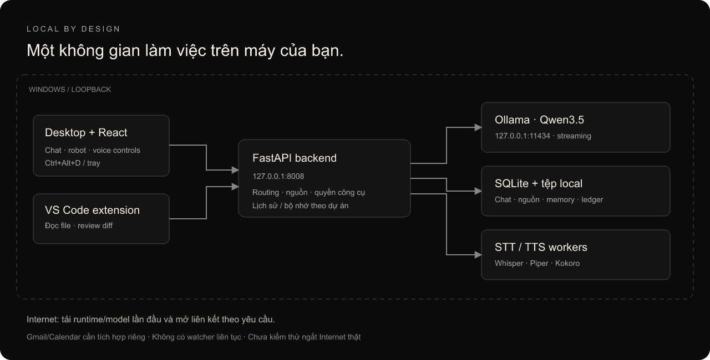
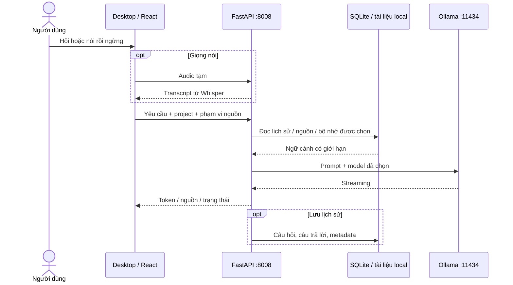

# Kiến trúc

Electron mở UI React do FastAPI phục vụ; có cửa sổ chính, robot và cửa sổ chat nhanh riêng. Preload dùng contextIsolation, renderer không có Node integration và bật sandbox Electron. Ctrl+Alt+D và khay hệ thống cung cấp đường điều khiển khi robot xuyên chuột.

Backend `app/main.py` ghép các router. Chat gửi sự kiện NDJSON cho UI, giữ trạng thái sinh/hủy/lỗi và lưu SQLite khi bật lịch sử. Token ngân sách được chia cho system prompt, ngữ cảnh, lịch sử và đầu ra. Routing xem yêu cầu và lịch sử gần nhất; sự nhận diện này là heuristic.

Voice chạy worker riêng để tái sử dụng engine và quản lý bộ nhớ. Detector năng lượng dùng chung qua `frontend/src/voiceActivity.ts`, được sinh sang `desktop/voice-turn.js`. Audio worklet/MediaRecorder không phải xác thực người nói. Luồng mở ứng dụng trên desktop tách thành nhận dạng lệnh → xác nhận rõ ràng → phát lời đáp → mở ứng dụng trong allowlist.

Nguồn tài liệu được chia đoạn, lập chỉ mục SQLite FTS5 và trích dẫn bằng version/hash/vị trí. Đây là truy hồi từ khóa, chưa phải vector search. Di chuyển hội thoại chỉ đổi phạm vi cuộc chat và message; tài liệu/bộ nhớ giữ dự án cũ.

Coding agent đọc context trong thư mục được cấp, lưu đề xuất diff rồi đợi áp dụng. Hash guard ngăn ghi đè file đã sửa; rollback là cơ chế ứng dụng, không phải filesystem transaction hoặc OS sandbox. Công cụ tính chỉ được tự cấp theo registry/digest sau probe; khai báo schema không đồng nghĩa mọi tool đều được phép.

Career ledger giữ cơ hội/JD/approval/email/event receipt; không có tài khoản Gmail/Calendar bên trong. Bản ghi biên nhận có schema kiểm tra nhưng không tự chứng minh đã gửi nếu không có tích hợp thực tế. Training Studio quản lý ví dụ/đồng ý/phạm vi, không chứa trainer trọng số.
